<p align="center">
  
</p>

<h1 align="center">Estimay</h1>

<p align="center">
  Free, real-time planning poker for agile teams. No sign-up, no accounts: name a room, share the link, estimate.
</p>

<p align="center">
  <a href="https://estimay.io"></a>
  
  
  <a href="https://estimay.io/privacy"></a>
  <a href="https://estimay.io/mcp-scrum-poker"></a>
</p>

<p align="center">
  <a href="https://claude.ai/directory/estimay"></a>
  <a href="https://workspace.google.com/marketplace/app/estimay/145713655865"></a>
  <a href="https://t.me/estimaybot"></a>
  <a href="https://github.com/grynyk/estimay-claude"></a>
  <a href="https://github.com/grynyk/estimay-public"></a>
</p>

<p align="center">
  <a href="https://estimay.io"><strong>estimay.io</strong></a> ·
  <a href="https://estimay.io/features">Features</a> ·
  <a href="https://estimay.io/integrations">Integrations</a> ·
  <a href="https://estimay.io/developers">Developers</a> ·
  <a href="CHANGELOG.md">Changelog</a> ·
  <a href="ROADMAP.md">Roadmap</a>
</p>

<p align="center">
  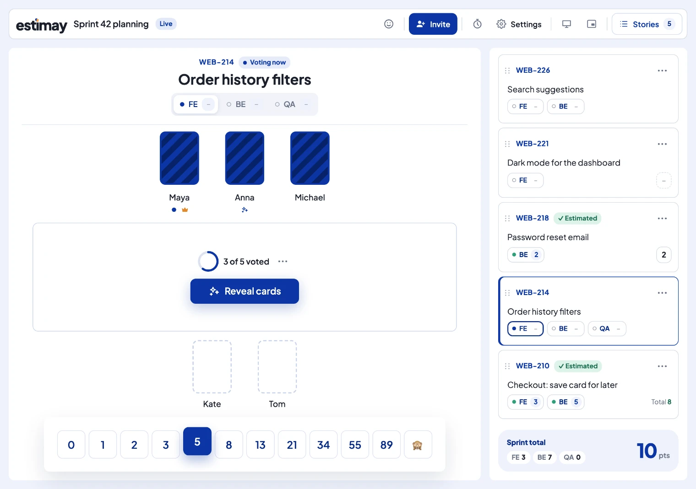
</p>

> [!NOTE]
> Estimay is a hosted web app at [estimay.io](https://estimay.io). This repository is its public home for bug reports, feature requests, the changelog and the roadmap; the app's source code isn't published here.

## Features

- **Live rooms** with a reveal countdown, auto-reveal once everyone has voted, a discussion timer with a bell, and emoji reactions.
- **Async rooms** for distributed teams: every story opens for voting as soon as it's added, and people vote in their own time, over hours or days.
- **Decks** for story points, T-shirt sizes and AI tokens, or your own cards (see below), plus [printable cards](https://estimay.io/printable-planning-poker-cards).
- **Extra questions** voted next to the estimate (Risk, Clarity, Agent-ready, AI tokens), and disciplines such as frontend and backend, each with its own sprint total.
- **Roles:** the host, any number of facilitators, voters and spectators. A host who has to leave can hand the room over.
- **Presenter view** for a shared screen, with a QR code to join, fullscreen, and a floating always-on-top scoreboard in Chrome and Edge.
- **Stories** typed in, pasted as tracker links, imported from CSV or a tracker, reordered in a queue, and exported as CSV when you're done.
- **Private by default:** no accounts, hosted in the EU (Amsterdam), and rooms are deleted 7 days (live) or 30 days (async) after they were last used.

Every feature available today is free, with no card needed.

## Decks

| Deck               | Cards                                                  |
| ------------------ | ------------------------------------------------------ |
| Fibonacci          | 0, 1, 2, 3, 5, 8, 13, 21, 34, 55, 89, 🙈               |
| Modified Fibonacci | 0, ½, 1, 2, 3, 5, 8, 13, 20, 40, 100, 🙈               |
| T-shirt sizes      | XS, S, M, L, XL, ?, 🙈                                 |
| Powers of two      | 0, 1, 2, 4, 8, 16, 32, 64, 🙈                          |
| AI tokens          | 10k, 25k, 50k, 100k, 250k, 500k, 1M, 2.5M, 5M, 10M+, ? |
| Custom             | 2 to 20 cards of your own, up to 5 characters each     |

`?` and 🙈 never count towards the result.

## Works with your tools

| Kind          | Apps                                                                                                                                                                                                                                                 | What they do                                                           |
| ------------- | ---------------------------------------------------------------------------------------------------------------------------------------------------------------------------------------------------------------------------------------------------- | ---------------------------------------------------------------------- |
| Chat and call | [Google Meet](https://estimay.io/google-meet-scrum-poker), [Telegram](https://estimay.io/telegram-scrum-poker), [Slack](https://estimay.io/slack-scrum-poker) (experimental), [Discord](https://estimay.io/discord-scrum-poker) (experimental)       | Start and join rooms without leaving the app, with your name filled in |
| Trackers      | [Jira](https://estimay.io/jira-scrum-poker), [Linear](https://estimay.io/linear-scrum-poker), [Trello](https://estimay.io/trello-scrum-poker), [Asana](https://estimay.io/asana-scrum-poker), [GitHub Issues](https://estimay.io/github-scrum-poker) | Import stories, then write the agreed estimates back                   |
| AI assistants | [Claude](https://claude.ai/directory/estimay), Claude Code, Cursor, ChatGPT, VS Code ([remote MCP](https://estimay.io/mcp-scrum-poker))                                                                                                              | Set up a room, add stories, run a round and record the estimates       |

Connecting a tracker is optional and belongs to the room: if you don't connect one, Estimay never touches your backlog.

### MCP server

Estimay has a remote MCP server at `https://estimay.io/api/mcp` (Streamable HTTP, OAuth). It signs the assistant in as the same guest as your browser, with read-only or read-and-write access, and you can disconnect it at [estimay.io/connect/assistant](https://estimay.io/connect/assistant).

```bash
claude mcp add --transport http estimay https://estimay.io/api/mcp
```

Or install the Claude Code plugin, which adds a planning poker skill on top:

```
/plugin marketplace add grynyk/estimay-claude
/plugin install estimay@estimay
```

Tools: `create_room`, `join_room`, `list_rooms`, `get_room`, `add_stories`, `import_stories`, `start_voting`, `vote`, `reveal`, `set_estimate`, `edit_story`, `delete_story`, `revote`, `start_timer`, `change_deck`, `set_disciplines`, `set_facilitator`, `export_results`, `write_estimates`, `end_room`. Every room you're in is also a resource (`estimay://rooms/{code}`).

The assistant prepares the room and records the outcome; the vote stays with the team. It never sees a card before the reveal. Every tool and its arguments: [estimay.io/developers](https://estimay.io/developers).

## The fun bits

<table>
  <tr>
    <td width="50%">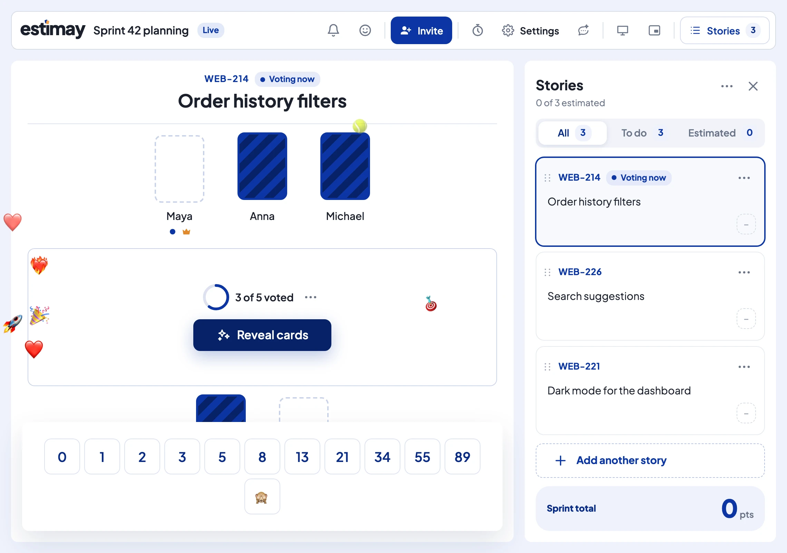<br><sub>Throw a 🎾 or a 🎯 at a teammate's card, or float ❤️ and 🎉 up everyone's screen.</sub></td>
    <td width="50%">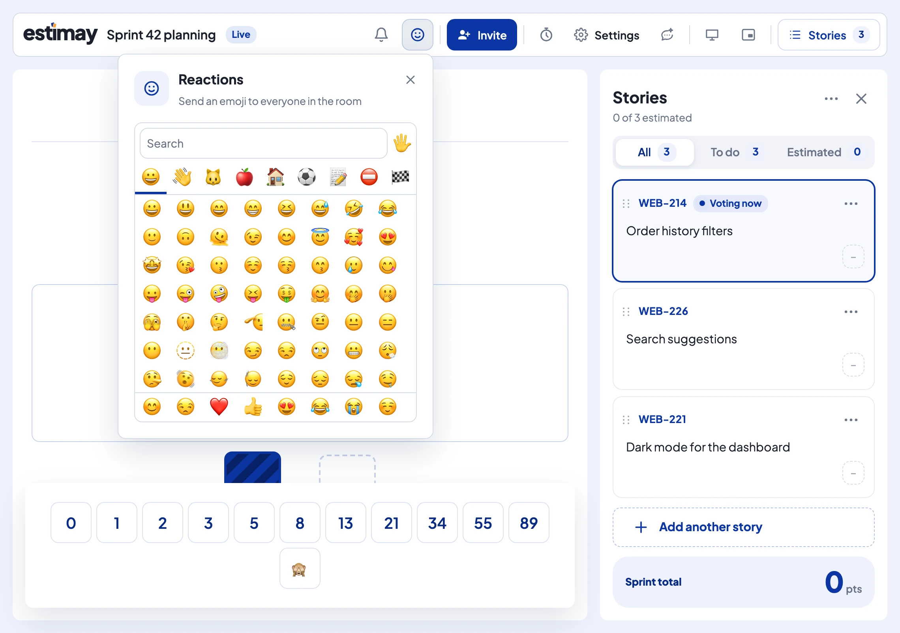<br><sub>Any emoji, from a picker that stays open for more.</sub></td>
  </tr>
  <tr>
    <td>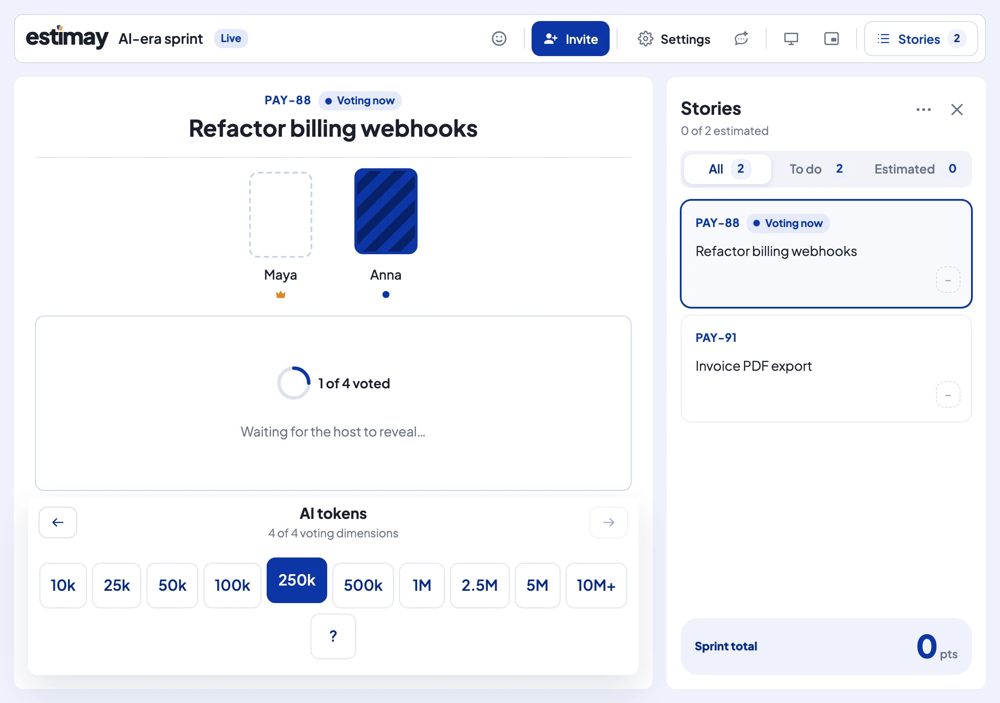<br><sub>AI tokens, Risk and Agent-ready, voted next to the story points.</sub></td>
    <td>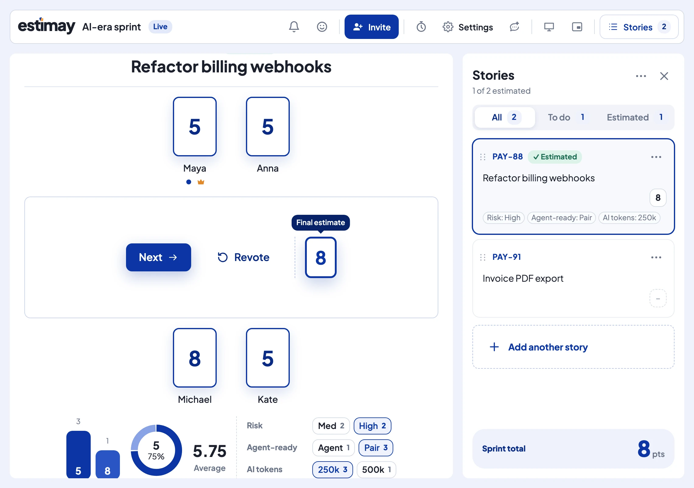<br><sub>Their answers after the reveal, kept with the story.</sub></td>
  </tr>
  <tr>
    <td>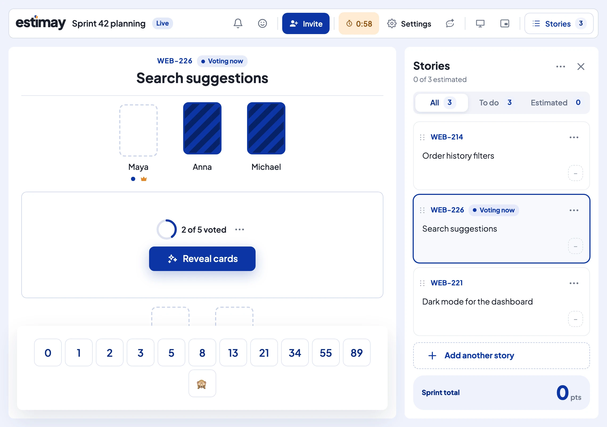<br><sub>A discussion timer for the whole room, with a bell when time's up.</sub></td>
    <td>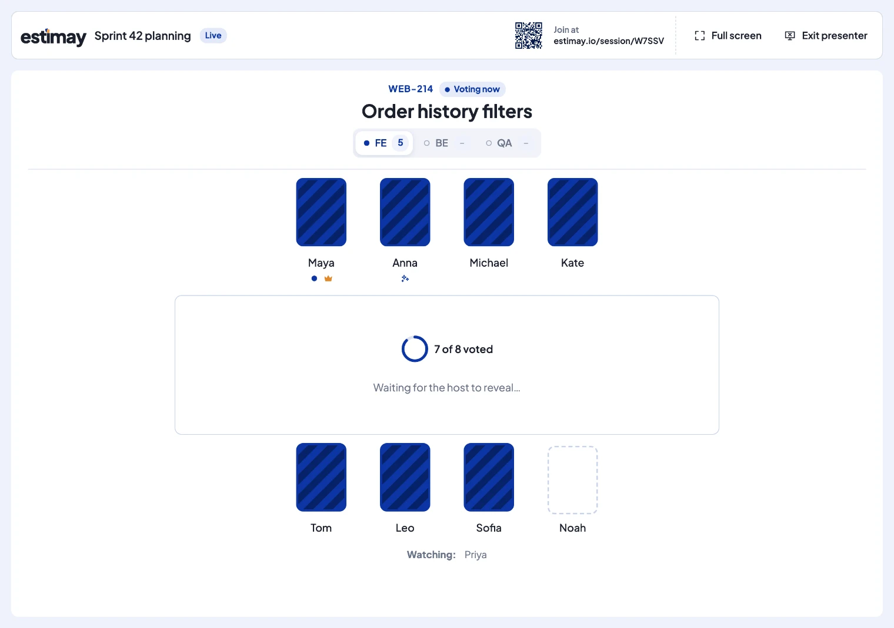<br><sub>A presenter view for the shared screen, with a QR code to join.</sub></td>
  </tr>
  <tr>
    <td colspan="2">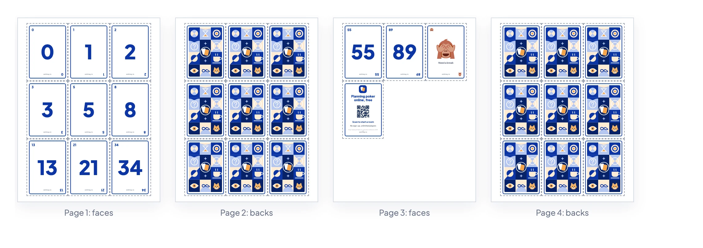<br><sub><a href="https://estimay.io/printable-planning-poker-cards">Printable cards</a> for teams who'd rather hold them: any deck, A4 or US Letter, faces and backs.</sub></td>
  </tr>
</table>

## Screenshots

<table>
  <tr>
    <td width="50%">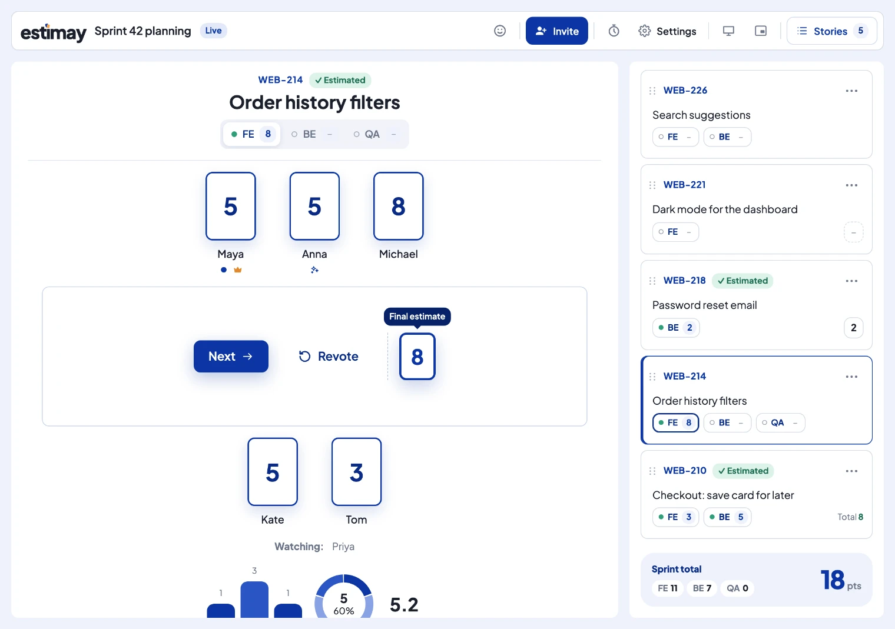</td>
    <td width="50%">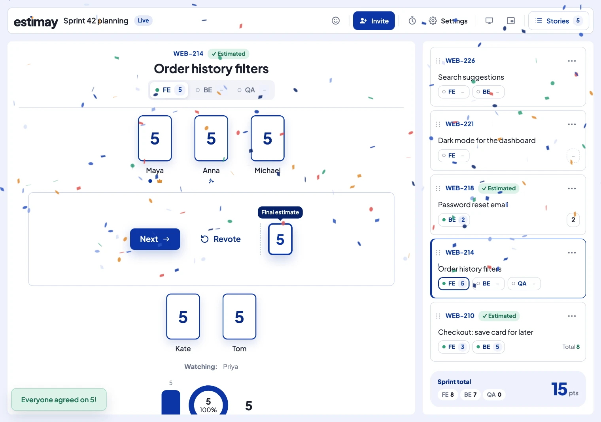</td>
  </tr>
  <tr>
    <td>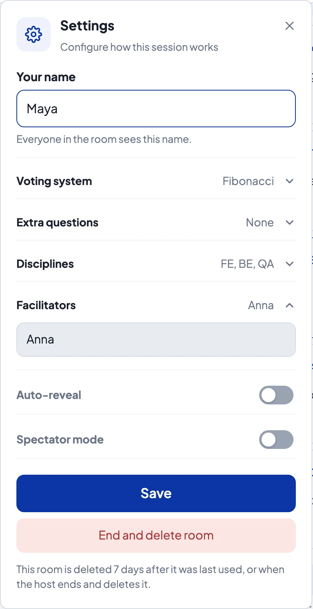</td>
    <td>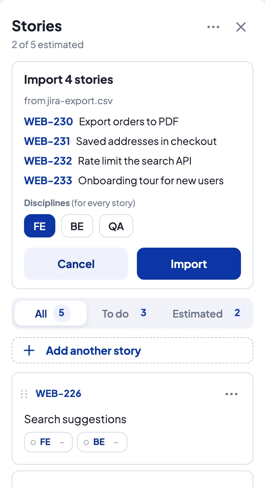</td>
  </tr>
  <tr>
    <td>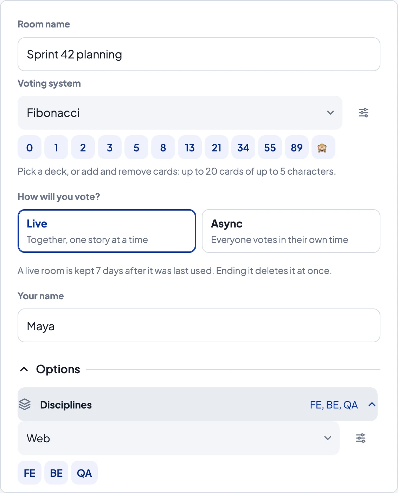</td>
    <td>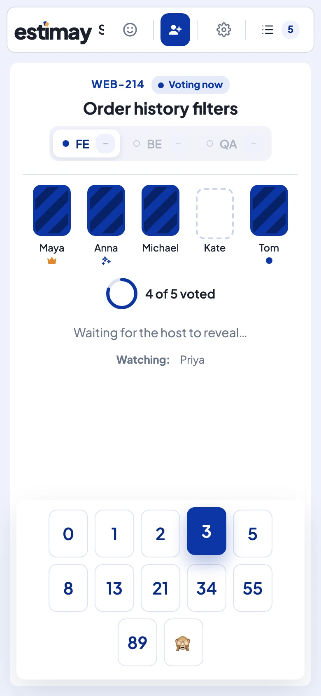</td>
  </tr>
</table>

## Feedback and support

- **Found a bug or want a feature?** [Open an issue](https://github.com/grynyk/estimay-public/issues/new/choose).
- **Security issue?** Don't open an issue; see [SECURITY.md](SECURITY.md).
- **Anything else:** [hello@estimay.io](mailto:hello@estimay.io).

Privacy, security and terms: [estimay.io/privacy](https://estimay.io/privacy), [estimay.io/security](https://estimay.io/security), [estimay.io/terms](https://estimay.io/terms).

## License

The contents of this repository (the docs, images and templates) are under the [MIT License](LICENSE). The Estimay app itself is a hosted service and isn't covered by it.
